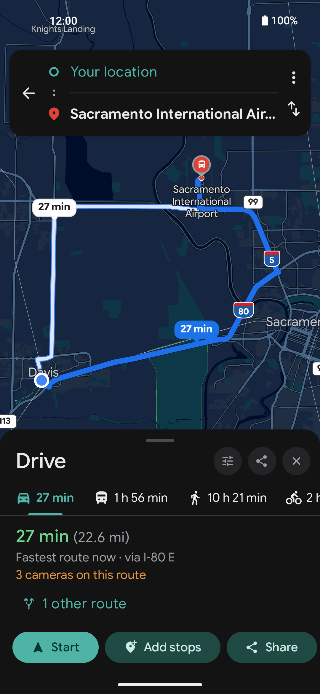

<div align="center">


# Waylo Maps

**The map from OpenStreetMap, the live data from Google, in one Android app.**

Driving guidance with real traffic, place pages that know their opening hours, and not one Google
binary on your phone. No Play Services, no sign-in, no API key.

[](https://github.com/ProTechPh/Waylo/releases/latest)
[](https://github.com/ProTechPh/Waylo/releases)
[](https://github.com/ProTechPh/Waylo/releases/tag/canary)
[](https://github.com/ProTechPh/Waylo/actions/workflows/ci.yml)
[](LICENSE)
[](https://github.com/ProTechPh/Waylo/stargazers)

[](https://github.com/ProTechPh/Waylo/releases/latest)
[](https://protechph.github.io/Waylo/docs/)
[](PRIVACY.md)
[](https://protechph.github.io/Waylo/)

<p><a href="#a-look-at-it">Screenshots</a> · <a href="#what-it-does">Features</a> · <a href="#what-google-receives">Privacy</a> · <a href="#getting-it">Install</a> · <a href="#channels">Channels</a> · <a href="#documentation">Docs</a> · <a href="#questions-people-ask">FAQ</a></p>

</div>

> [!WARNING]
> This is beta software. Expect the odd break, report it through the issue template, and keep a
> second maps app installed. Nightly and canary builds are newer and less tested than the weekly
> stable.

Think of NewPipe, but for maps. Waylo takes the map from open data and asks Google only for the
things open data does not have.

**No ads. No account. No analytics. Nothing from Play Services.**

The tiles are OpenStreetMap. The shops, addresses and points of interest drawn on top are **Waylo
data**, assembled from Overture Maps and AllThePlaces, positioned with OpenStreetMap, baked into
tiles in this repository and served from its releases. Moving the map around sends nothing
anywhere. Once you search, tap a place or plan a drive, your own phone queries Google's public web
endpoints, the way a logged-out browser would: no login, no shared key, nobody's server in the
middle. That covers traffic, opening hours, reviews, photos and roads that turn out to be closed.
Degoogled systems like GrapheneOS are the target, and it installs on ordinary Android as well.

## A look at it

<table>
  <tr>
    <td align="center"><br><sub><b>On the road</b>: lanes, exit shields, posted limit</sub></td>
    <td align="center"><br><sub><b>Place pages</b> with hours, reviews and photos</sub></td>
    <td align="center"><br><sub><b>Route choices</b> ranked by real traffic</sub></td>
  </tr>
  <tr>
    <td align="center"><br><sub><b>Open tiles</b> in Google's palette</sub></td>
    <td align="center"><br><sub><b>Departure boards</b> from agency timetables</sub></td>
    <td align="center"><br><sub><b>Two themes</b>, switched whenever you like</sub></td>
  </tr>
</table>

## What it does

| | |
| --- | --- |
| **Drives you the way Google would** | The car route comes from Google, so jams and closures are already in it. Times show green, amber or red and the words light, moderate or heavy say the same thing. Lane pictures, exit signs, the limit on the speedometer and a nudge toward a quicker road all appear while you move. OSRM and Valhalla write the instructions |
| **Shows open places, asks Google for detail** | Pins, dots and labels are Waylo's own data, so panning never phones home. Tap one and Waylo asks Google for everything open data lacks: hours, holiday closures, searchable reviews, photos, how busy it is, phone and site. The map's place source lives under Settings → Places, with a switch that turns the tap lookup off |
| **Keeps Google off the device** | Nothing from Play Services, no login, no key, no advertising. Neither your browsing nor your saved places reach Google, and your position history stays in local storage. A position leaves the phone only inside a few requests: a route that starts here, a search that sorts nearby first, and the traffic polling of an active drive |
| **Draws the surveillance cameras** | Camera positions from the DeFlock community, carried in OpenStreetMap, appear without setup. The "Avoid surveillance cameras" option counts what faces along each candidate and picks a lighter one when the detour stays short, and can warn you by card or by voice |
| **Speaks without a server** | The voice that reads directions is neural and runs on the device, and so does dictation for search. Nothing you say is uploaded |
| **Works with no signal** | Save a state, a country or only what is on screen, and its map, its places, addresses you type and the guidance all keep working |
| **Shows live transit** | Boards and the whole stop list of a run come from agency GTFS through the community Transitous service. Google supplies transit routes, the open planner is the fallback. Lines keep their colors and a journey follows its track |
| **Covers the small stuff** | Street View in a panel or full screen, fuel prices on markers, P to remember the car, lists with notes, saved routes, home-screen shortcuts, an import for shared Google Maps lists, and 19 languages plus keypad-only navigation and Android Auto |

There is [a longer list](FEATURES.md) if you want every item.

## What Google receives

| Your action | What Google learns |
| --- | --- |
| Moving the map | **Nothing.** Tiles are OpenFreeMap's; streets and labels are OpenStreetMap's |
| Looking at pins and labels | **Nothing where Waylo has data.** An area it does not cover shows Google's places, and the area goes to Google with them |
| Pinning an address | **Nothing.** Nominatim names it |
| Searching | The words, anonymously, while you type and when you submit |
| Opening a place | One lookup of that place, on a logged-out cookie |
| Planning a route | Where it begins and ends, anonymously. A walk asks Google once; bicycles and offline routes never leave the phone |
| Driving with guidance | A traffic poll from your position every couple of minutes, which you can switch off |
| Saving anything | **Nothing at any time.** Lists, history and preferences stay local |

Switch on **Settings → Privacy → Use Waylo without Google**, or work from a downloaded region, and
Google gets no request at all. The full request-by-request account is in [PRIVACY.md](PRIVACY.md),
and [the site](https://protechph.github.io/Waylo/#google) carries the same table with commentary.

## Getting it

Grab the APK from **[Releases](https://github.com/ProTechPh/Waylo/releases/latest)** and open it.
From then on the app can update itself.

Releases since the nightly of October 22, 2026 ship one APK per chip type next to an all-in-one
file. `waylo-maps-arm64.apk` fits nearly every phone; `waylo-maps-all.apk` fits the rest. The updater
picks correctly on its own. Android 8 or newer, package `app.waylo`.

<details>
<summary><b>Verify what you downloaded</b></summary>

One signing key covers every Waylo build on every channel. Its certificate fingerprint:

```
SHA-256  CF:07:EB:D6:9C:AA:83:06:88:64:7F:00:26:6B:A8:7F:76:41:95:1F:D5:43:65:BA:73:DF:2F:E7:90:23:25:B9
```

Check a file against it first:

```bash
apksigner verify --print-certs waylo-maps-*.apk
```

[App Verifier](https://github.com/soupslurpr/AppVerifier) does the same on the phone, expecting the
package name then the fingerprint:

```
app.waylo
CF:07:EB:D6:9C:AA:83:06:88:64:7F:00:26:6B:A8:7F:76:41:95:1F:D5:43:65:BA:73:DF:2F:E7:90:23:25:B9
```

Android checks the key itself from the second install onward, refusing anything signed differently.
The value identifies the certificate rather than one APK, and it never changes.

</details>

## Channels

| Channel | What it is | Where it comes from |
| --- | --- | --- |
| Stable | A nightly that spent a week in the wild. The same signed APK, no rebuild | Promoted weekly from the newest nightly |
| Nightly | One build a day from `main`, when `main` has moved | Settings → About → Update channel |
| Canary | Every push to the `canary` branch, replaced on each one | The same screen, or the `canary` release |

All three carry the same signing key, so switching channels never needs a reinstall. The versions in
the badges above are read from the releases themselves.

## Documentation

| Start with | It contains |
| --- | --- |
| [The docs site](https://protechph.github.io/Waylo/docs/) | All of this, searchable in a browser |
| [`SPEC.md`](SPEC.md) | The rules, contracts and constants behind everything |
| [`docs/book/`](docs/book/README.md) | Plain-language chapters on places, routing, guidance, offline data and transit |
| [`PRIVACY.md`](PRIVACY.md) | Each service contacted and what it is told |
| [`docs/FAQ.md`](docs/FAQ.md) | What people ask before installing |
| [`FEATURES.md`](FEATURES.md) | Every capability on one line |
| [`ROADMAP.md`](ROADMAP.md) | What is still open |
| [`docs/BUILDING.md`](docs/BUILDING.md) | How to compile it yourself |
| [`CONTRIBUTING.md`](CONTRIBUTING.md) | The rules for a patch, and where to send it |

## Questions people ask

**Is it a wrapper around Google Maps?** No. It is a native app drawing open tiles; only the data for
a place or a route comes from Google.

**Does it need Play Services?** No. Position comes from Android's own location service, so it runs on
GrapheneOS and on stock Android.

**Does everything work offline?** With a downloaded region, the map, its places, addresses you type
and the guidance all do.

**Why is a shop missing?** Open data lags behind reality. The bake picks up changes from
OpenStreetMap and Overture on a schedule, and a place you tap is checked against Google.

More answers are in [the FAQ](docs/FAQ.md).

## Feedback

Bugs go to [the issue tracker](https://github.com/ProTechPh/Waylo/issues/new/choose); the template
asks for the version and the steps. Questions and ideas belong in
[Discussions](https://github.com/ProTechPh/Waylo/discussions). Security problems go through
[SECURITY.md](SECURITY.md), never a public issue.

## Where it came from

Google Maps needs Play Services, which a GrapheneOS phone does not have, and the open datasets
alone cannot tell you about traffic, reviews or a shop that shut last month. So I wrote the app I
wanted: open data for the map, and Google's own public endpoints, called from the handset exactly
as a logged-out browser calls them.

The interface follows Google Maps on purpose. It is the pattern people already know, and knowing it
matters at 70 km/h. One person maintains it, the license is GPLv3 so it survives me, and it will
never ask for money.

## On GrapheneOS

Position comes from Android's `LocationManager`, never the fused provider Google ships. PSDS, under
Settings → Location, shortens a cold fix from about half a minute to moments. Inside buildings a fix
may never arrive, so enable Network location (Settings → Location → Location services); Waylo
surfaces a hint when nothing has come in after a few seconds.

## Data and license

Tiles are [OpenStreetMap](https://www.openstreetmap.org/copyright) data, © OpenStreetMap
contributors, under the Open Database License, vectorized by [OpenFreeMap](https://openfreemap.org).
Shops and points of interest are Overture Maps (CDLA-Permissive 2.0) and AllThePlaces, placed with
OpenStreetMap. Transit boards come from Transitous and the operators' GTFS. UK fuel prices come from
the government's Fuel Finder via
[matthewgall/fuelfinder-archive](https://github.com/matthewgall/fuelfinder-archive), containing
public sector information under the Open Government Licence v3.0. Satellite pictures are Esri's.
Closures are spotted with Foursquare OS Places, OpenStreetMap and Wikidata.

Waylo itself is Free Software under the [GPLv3](LICENSE): use it, read it, share it, improve it, and
keep any redistribution under the same terms. The bundled Google Sans Flex font is covered by the
[SIL Open Font License 1.1](app/src/main/assets/licenses/GoogleSansFlex-OFL.txt). Waylo has no
affiliation with Google and is not endorsed by it; Google Maps and Google Sans Flex are its
trademarks.

<p align="center"><sub>Made by <a href="https://github.com/ProTechPh">ProTechPh</a> · <a href="https://buymeacoffee.com/ProTechPh">Support</a></sub></p>
