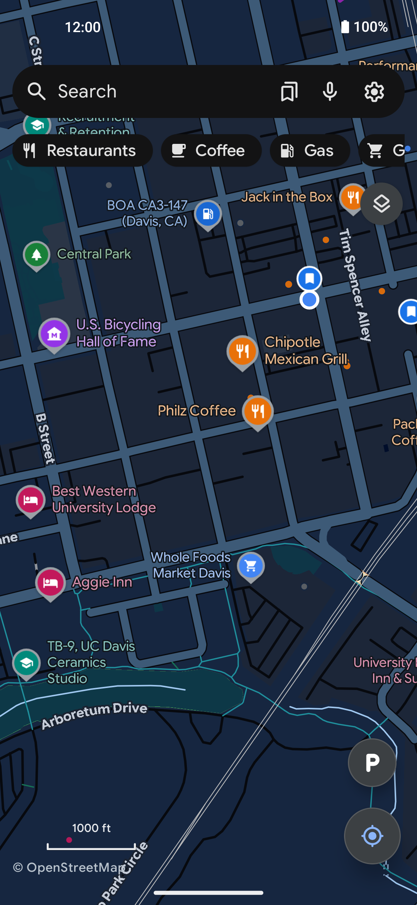
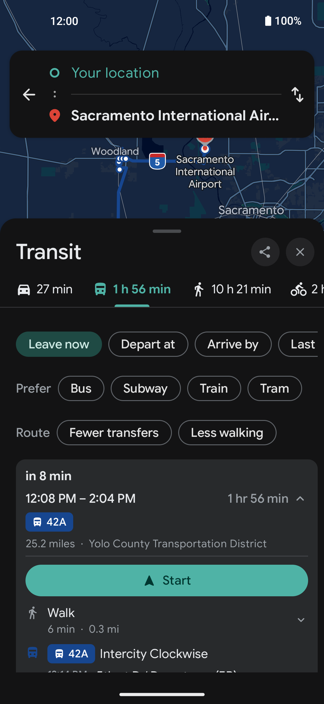
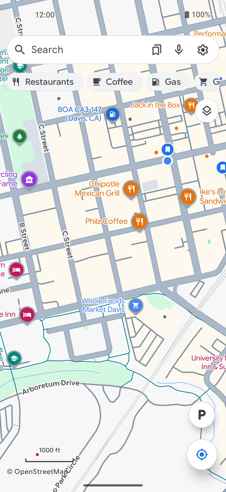
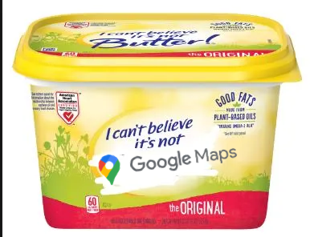

<div align="center">


# Waylo Maps

**OpenStreetMap's map and Google's live data, in one Android app.**

Turn-by-turn navigation that knows about traffic, place pages with real hours and reviews, and no
Google account, no Play Services and no Google code running on the phone.

[](https://github.com/ProTechPh/Waylo/releases/latest)
[](https://github.com/ProTechPh/Waylo/actions/workflows/ci.yml)
[](LICENSE)
[](https://github.com/ProTechPh/Waylo/stargazers)

[](https://github.com/ProTechPh/Waylo/releases/latest)
[](https://protechph.github.io/Waylo/docs/)
[](PRIVACY.md)
[](https://protechph.github.io/Waylo/)

</div>

> [!WARNING]
> Waylo is in beta. Bugs happen. When one does, open an issue and fill in the template. Nightly and
> canary builds are fresher and less tested than the weekly stable.

Waylo replaces Google Maps on Android the way NewPipe replaces YouTube: open map data where it is
good enough, and Google's own public web endpoints for the few things only Google has.

The map is open. Tiles come from OpenStreetMap, and the businesses, addresses and other places on
top of them are **Waylo data**: Overture Maps and AllThePlaces, placed with OpenStreetMap, baked
into tiles here and downloaded from this repository's releases. Panning and zooming never ask
Google anything. Searching, opening a place or requesting a route is when the phone contacts
Google's public web endpoints itself, with no account, no key and no server in between, for live
traffic, opening hours, reviews, photos and roads that are closed. It is made for degoogled systems
such as GrapheneOS, and it installs on stock Android too.

## See it

<table>
  <tr>
    <td align="center"><br><sub><b>Turn by turn</b> with lanes, shields and a speedometer</sub></td>
    <td align="center"><br><sub><b>Apps open</b> for hours, reviews and photos</sub></td>
    <td align="center"><br><sub><b>Routes</b> with real traffic and avoid switches</sub></td>
  </tr>
  <tr>
    <td align="center"><br><sub><b>The map</b>, open data in Google's colors</sub></td>
    <td align="center"><br><sub><b>Transit</b> boards from open timetables</sub></td>
    <td align="center"><br><sub><b>Light or dark</b>, chosen in the app</sub></td>
  </tr>
</table>

<p align="center"></p>

## What you get

| | |
| --- | --- |
| **Google's routes, with Google's traffic** | A driving route is the one Google would return, aware of jams and closures. Each option is timed in green, amber or red and marked light, moderate or heavy. Guidance adds lane diagrams, exit shields, a speedometer with the posted limit, and a faster-route offer. OSRM and Valhalla supply the turn instructions |
| **Open place data, Google for the details** | Everything drawn on the map is Waylo data. Browsing sends Google nothing. Opening a place asks Google for hours with holidays, searchable reviews, photos, busy times, phone and website. Settings → Places switches the map between Waylo data, Both and Google |
| **No Google software on the phone** | No Play Services, no account, no app key, no ads. Map browsing and saved places stay off Google, and the GPS trail never leaves the device. Only specific requests carry a position: a route from here, a search ranked nearby first, and a drive's reroute and traffic checks |
| **Surveillance cameras on the map** | Mapped plate readers from the community DeFlock project are drawn with no setup. "Avoid surveillance cameras" counts what faces along each route and prefers a cleaner one when the detour is short, with a card or a spoken warning as you approach one |
| **A voice that stays on the phone** | Directions are spoken by a neural voice that runs locally, and the microphone transcribes search locally too. Nothing you say goes to a speech service |
| **Offline maps and routing** | Download a state, a country or just the area on screen. Its map, places, typed street addresses and turn-by-turn guidance keep working with no signal |
| **Public transit** | Departure boards and the full stop list of each run, from the timetables agencies publish through the community Transitous project. Rail lines keep their colors and a trip follows its real track |
| **Street View, gas prices, parking** | Look around a street, read fuel prices in search results and on the map, and tap P to remember where you parked |
| **Lists and saved routes** | Group places with a note on each, save a route, pin a trip to the home screen, export the lot, and import a shared Google Maps list by pasting the link into search |
| **The rest** | 19 languages, light and dark themes, wallpaper colors, full D-pad operation on keypad phones, an updater with stable, nightly and canary channels, and Android Auto screens |

[The complete list](FEATURES.md) has one line for every feature.

## What reaches Google

| When you | Google gets |
| --- | --- |
| Pan and zoom the map | **Nothing.** OpenFreeMap serves the tiles, OpenStreetMap the streets and labels |
| Look at the places on the map | **Nothing, while Waylo has data for the area.** An area without data shows Google's places, and Google is sent that area |
| Drop a pin or read a house number | **Nothing.** Nominatim names the spot |
| Type a search | The text, anonymously, during typing and on submit |
| Open a place | One anonymous lookup, under a logged-out cookie |
| Ask for a route | The start and end points, anonymously. Walking asks Google once; cycling and offline routes stay on the phone |
| Drive with guidance on | A traffic check from your position every couple of minutes, unless you turn it off |
| Save a place or build a list | **Nothing, ever.** Everything saved stays on the phone |

Offline, or with **Settings → Privacy → Use Waylo without Google** on, nothing reaches Google at
all. [PRIVACY.md](PRIVACY.md) lists every request, and the [landing page](https://protechph.github.io/Waylo/#google)
has the same table with the reasoning.

## Install

Take the APK from **[Releases](https://github.com/ProTechPh/Waylo/releases/latest)** and open it.
The app updates itself after that.

There is one APK per chip type since the nightly of October 22, 2026, and nearly every phone wants
`waylo-maps-arm64.apk`. `waylo-maps-all.apk` runs on anything. The built-in updater picks the right
file by itself. Android 8 and up; the package is `app.waylo`.

<details>
<summary><b>Check that you got the real thing</b></summary>

Every Waylo APK, on every channel, is signed with the same key. The certificate fingerprint is:

```
SHA-256  86:B8:1F:DF:A3:CF:7E:96:B1:9A:DA:62:31:B9:6F:4F:C1:18:1C:1C:7E:6E:86:FA:E5:39:CA:B1:90:40:6D:BB
```

Compare a download against it before installing:

```bash
apksigner verify --print-certs waylo-maps-*.apk
```

[App Verifier](https://github.com/soupslurpr/AppVerifier) runs the same check on the phone. It wants
the package name on the first line and the fingerprint on the second:

```
app.waylo
86:B8:1F:DF:A3:CF:7E:96:B1:9A:DA:62:31:B9:6F:4F:C1:18:1C:1C:7E:6E:86:FA:E5:39:CA:B1:90:40:6D:BB
```

Android enforces the key after the first install: an update signed with a different one is refused.
The fingerprint belongs to the certificate, not to one APK, and it does not change between releases.

</details>

## Read more

| Where | What is there |
| --- | --- |
| [The docs site](https://protechph.github.io/Waylo/docs/) | Everything below, searchable, in a browser |
| [`SPEC.md`](SPEC.md) | Every technical rule, contract and constant |
| [`docs/book/`](docs/book/README.md) | Each subsystem explained: places, routing, navigation, offline, transit |
| [`PRIVACY.md`](PRIVACY.md) | What each service receives, request by request |
| [`docs/FAQ.md`](docs/FAQ.md) | The questions people ask first |
| [`FEATURES.md`](FEATURES.md) | What the app does, one line each |
| [`ROADMAP.md`](ROADMAP.md) | What is open and what is next |
| [`docs/BUILDING.md`](docs/BUILDING.md) | Building from source |
| [`CONTRIBUTING.md`](CONTRIBUTING.md) | The hard rules, and how to send a change |

## Why this exists

I run GrapheneOS, and Google Maps stopped working for me without Google's services. I need traffic
and the handful of things pretty much only Google does well, and no app I tried fit. So I built one.
The map is OpenStreetMap and other open data. When you search, tap a place or ask for a route, the
phone asks Google the way a logged-out browser would, as anonymously as it can. No account, no API
key, no server of mine in the middle.

It looks like Google Maps on purpose: that interface is the best there is, and muscle memory matters
when you are driving. It is in beta, one person maintains it, and it is GPLv3 so it can outlive me.
It will never cost money.

## GrapheneOS notes

Waylo reads position through Android's `LocationManager`, never Google's fused provider. Enabling
PSDS (Settings → Location) cuts the cold GPS fix from around 30 seconds to a few. Indoors, a fix may
not come at all, so turn on Network location (Settings → Location → Location services). Waylo shows
a tip when no position arrives after a few seconds.

## Data and license

The map is [OpenStreetMap](https://www.openstreetmap.org/copyright) data, © OpenStreetMap
contributors, under the Open Database License, served as tiles by
[OpenFreeMap](https://openfreemap.org). The places on the map are Overture Maps (CDLA-Permissive
2.0) and AllThePlaces, positioned with OpenStreetMap. Transit boards come from Transitous and the
agencies' own GTFS feeds. UK fuel prices come from the UK government's Fuel Finder through
[matthewgall/fuelfinder-archive](https://github.com/matthewgall/fuelfinder-archive) and contain
public sector information under the Open Government Licence v3.0. Satellite imagery is Esri World
Imagery. Closed places are filtered with Foursquare OS Places, OpenStreetMap and Wikidata.

Waylo is Free Software under the [GPLv3](LICENSE): you can use, study, share and improve it, and any
modification you redistribute stays under the same license. The app bundles the Google Sans Flex
font under the [SIL Open Font License 1.1](app/src/main/assets/licenses/GoogleSansFlex-OFL.txt).
Google Sans Flex and Google Maps are trademarks of Google LLC; Waylo is not affiliated with or
endorsed by Google.

<p align="center"><sub>Built by <a href="https://github.com/ProTechPh">ProTechPh</a> · <a href="https://buymeacoffee.com/ProTechPh">Support</a></sub></p>
