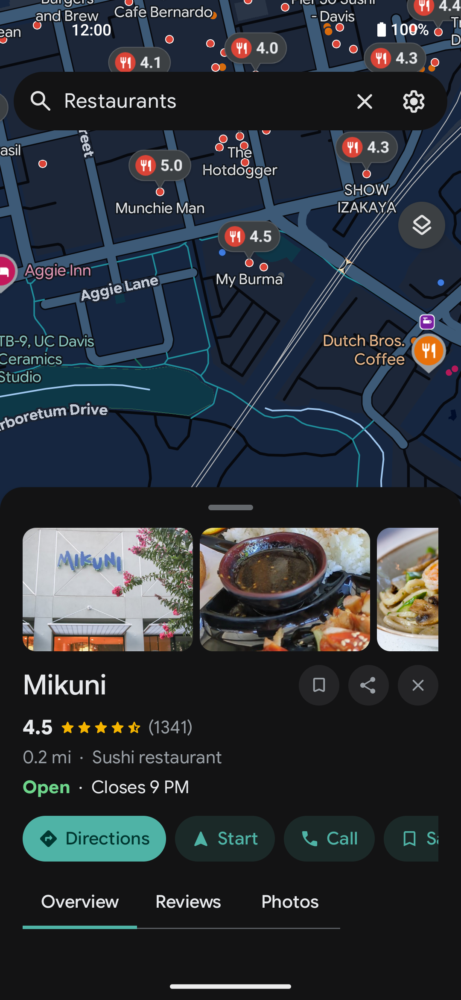
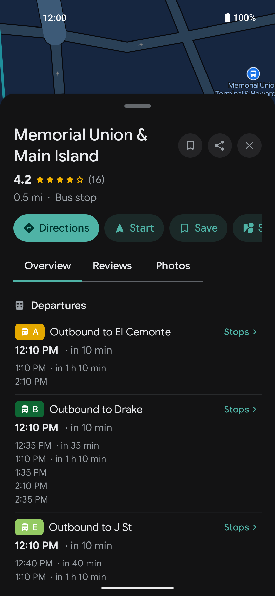
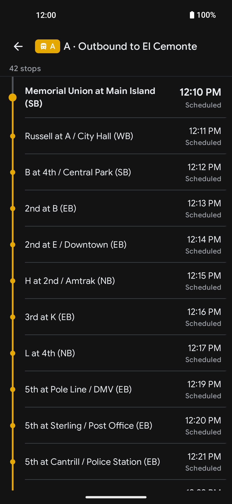

<div align="center">


# Waylo Maps

**OpenStreetMap's map and Google's live data, in one Android app.**

Turn-by-turn navigation that knows about traffic, place pages with real hours and reviews, and no Google account, no Play Services and no Google code running on the phone.

[](https://github.com/ProTechPh/Waylo/releases/latest)
[](https://github.com/ProTechPh/Waylo/actions/workflows/ci.yml)
[](LICENSE)
[](https://github.com/ProTechPh/Waylo/stargazers)
[](https://hosted.weblate.org/engage/waylo/)

[Install](#install) · [What you get](#what-you-get) · [Docs](https://protechph.github.io/Waylo/docs/) · [FAQ](docs/FAQ.md) · [The book](docs/book/README.md) · [Privacy](#privacy) · [How it works](SPEC.md) · [Build](docs/BUILDING.md) · [Discussions](https://github.com/ProTechPh/Waylo/discussions) · [Translate](https://hosted.weblate.org/engage/waylo/)

[](https://protechph.github.io/Waylo/)

</div>

> [!warning]
> **Waylo is still in beta, so bugs happen.** When one does, open an issue and fill in the
> template. Nightly and canary builds are fresher and less tested than the weekly stable.

Waylo is an open-source replacement for Google Maps on Android, built the way NewPipe
is built for YouTube: open map data where it is good enough, and Google's own public web
endpoints for the few things only Google has.

The map itself is open. The basemap is OpenStreetMap vector tiles, and the businesses,
addresses and other places on top of it are **Waylo data**: Overture Maps and
AllThePlaces, placed with OpenStreetMap, baked into tiles in this repository and
downloaded from its releases. Pans and zooms never ask Google for anything. It is when
you search, open a place or request a route that the phone itself contacts Google's
public web endpoints, with no account, no key and no server in between, for the data
that open sources do not carry: live traffic, opening hours, reviews, photos, and
routes that know a road is closed. It is built for degoogled systems such as
GrapheneOS, and it installs on stock Android as well.

<p align="center"></p>

## Where Google comes in

**Waylo is not a wrapper around Google Maps.** It is a native Android app that draws
open vector tiles, written with Jetpack Compose and MapLibre. Nothing Google ships is
inside it: no SDK, no Play Services, no API key, nothing to sign in to. The resemblance
to Google Maps is deliberate.

| What you do | What reaches Google |
| --- | --- |
| Move around the map | **Nothing.** OpenFreeMap serves the tiles, OpenStreetMap supplies streets and labels |
| The pins and labels you see | **Nothing, while Waylo has data for the area.** Overture Maps and AllThePlaces, placed with OpenStreetMap and baked here. An area Waylo has no data for gets Google's places, and Google is sent that area |
| Drop a pin or read a house number | **Nothing.** The spot is named by OpenStreetMap's Nominatim |
| Open a departure board | **Nothing, for stops covered by open transit data.** Transitous provides the board. Stops without coverage open their Google page instead |
| Request a route | **The start and end points, anonymously.** A driving route comes from Google, which is how traffic and closures are known. The turn-by-turn wording is laid over it by the open OSRM and Valhalla routers, which receive the same trip. While driving, Google is asked again after a wrong turn and every couple of minutes for traffic; Settings → Navigation can turn the second off. Walking and cycling routes come from the open routers (a walk asks Google once and keeps its route only when much shorter). Offline, the phone computes the route itself |
| Type into the search box | **The text, anonymously**, the way a logged-out browser would. Each pause sends Google's autocomplete, and submitting the form sends a Google search. A query that begins with a house number also goes to the open Photon geocoder |
| Open a place | **One anonymous lookup of that place**, with no account and no app key, for hours, reviews and photos. Settings → Places can disable lookups for places opened from the map |
| Anything you save | **Nothing, at any point.** No account, no waylo server, no waylo analytics; saved places, history and settings stay in the phone's storage |

With a region downloaded, the map, search, routing and turn-by-turn guidance all work
without a network. Offline, or with **Settings → Privacy → Use Waylo without Google**
switched on, Google receives nothing. The first launch asks which mode you want before
the map appears. A handful of things Google only serves to a real browser, reviews among
them, are read from a Google page in an offscreen WebView, still anonymously; the list
is in [PRIVACY.md](PRIVACY.md#the-hidden-pages).

**[The detailed comparison with the Google Maps app and website is below](#privacy)**, and
[PRIVACY.md](PRIVACY.md) breaks down every request.

## Screenshots

| Navigation | Map & search | Place details | Directions | Search results |
|:-:|:-:|:-:|:-:|:-:|
|  |  |  |  |  |

| Public transit | Departure board | Stops on the line | Light theme - map | Light theme - place |
|:-:|:-:|:-:|:-:|:-:|
|  |  |  |  |  |

*Lane guidance, exit shields and a speedometer during navigation. OpenFreeMap tiles in
Google's palette with Google Sans Flex labels. Place pages with data that is current.
A route picker with alternates, traffic and the avoid switches. Departure boards that
list every run at a stop. Light and dark themes, chosen in the app.*

## Install

[](https://apps.obtainium.imranr.dev/redirect?r=obtainium://add/https://github.com/ProTechPh/Waylo)

Obtainium follows the **weekly stable** release. For the **nightly** channel, enable
"include prereleases" there.

You can also take an APK straight from
[Releases](https://github.com/ProTechPh/Waylo/releases). Starting with the nightly of
October 22, 2026 there is one APK per chip type, and nearly every phone wants
`waylo-maps-arm64.apk`; `waylo-maps-all.apk` works on anything. Obtainium and the
built-in updater choose the right file on their own.

### Check you got the real thing

All Waylo APKs, whichever channel they came from, carry the same signing key. The
certificate fingerprint is:

```
SHA-256  86:B8:1F:DF:A3:CF:7E:96:B1:9A:DA:62:31:B9:6F:4F:C1:18:1C:1C:7E:6E:86:FA:E5:39:CA:B1:90:40:6D:BB
```

Compare a downloaded file against it before installing:

```bash
apksigner verify --print-certs waylo-maps-*.apk
```

[App Verifier](https://github.com/soupslurpr/AppVerifier) performs the same check on the
phone. It expects the package name on the first line and the fingerprint on the second,
so give it this block rather than the single line above:

```
app.waylo
86:B8:1F:DF:A3:CF:7E:96:B1:9A:DA:62:31:B9:6F:4F:C1:18:1C:1C:7E:6E:86:FA:E5:39:CA:B1:90:40:6D:BB
```

Once Waylo is installed, Android enforces the key by itself: an update signed with a
different one is refused, so anything that installs over your copy came from the same
signer.

That fingerprint belongs to the certificate, not to one APK, and it does not change
between releases.

The website lives at **[protechph.github.io/Waylo](https://protechph.github.io/Waylo/)**,
and the documents in this repository are published as a searchable site at
**[protechph.github.io/Waylo/docs](https://protechph.github.io/Waylo/docs/)**.

[](https://buymeacoffee.com/ProTechPh)

---


## What you get

- **Google's routes, with Google's traffic.** A driving route is the one Google would
  return, aware of live jams and closed roads. Each option is timed in green, amber or
  red and marked light, moderate or heavy. Guidance sits on top of it: lane diagrams,
  exit shields, a speedometer showing the posted limit, and an offer to switch when a
  faster route appears. The open OSRM and Valhalla routers supply the instructions.
- **Open place data first, Google for the details.** Everything drawn on the map is
  **Waylo data**: Overture Maps and AllThePlaces, positioned with OpenStreetMap, baked
  into tiles here, streamed from the releases and kept offline inside a downloaded
  region. Browsing sends Google nothing. Opening a place is what asks Google for the
  rest: hours including holidays, searchable reviews, photos, busy times, phone number,
  website, and a notice when the place will be shut on arrival. **Settings → Places →
  "Place icons on the map"** switches between Waylo data (the default), Both and Google,
  and another switch disables the lookup on tap. [The FAQ](docs/FAQ.md) lists what each
  feature depends on.
- **No Google software on the phone.** Not Play Services, not an account, not an app
  key, not ads. Google does not learn your browsing or your saved places, and the GPS
  trail never leaves the device. A position is sent only inside particular requests: a
  route that starts where you are, a search that ranks nearby places first, and the
  reroute and traffic checks of an active drive. [Privacy](#privacy) goes through them.
- **Surveillance cameras on the map.** Mapped license plate cameras from the community
  DeFlock project (through OpenStreetMap) are drawn without any setup. **Avoid
  surveillance cameras**, under Settings → Navigation or in the route picker, counts the
  cameras facing along each option and prefers a cleaner one when the detour is short.
  Two further switches give a card or a spoken warning as you near a camera. The dataset
  ships on the phone and refreshes weekly.
- **Waylo Voice.** Directions are spoken by a neural voice that runs locally, and the
  microphone transcribes your search locally too. Speech never goes to a service.

  🔊 **Hear it**, the in-app voice at its default pace:

  https://github.com/user-attachments/assets/17f246e4-51c8-4d01-998b-dcd7f29dc15f

- **Offline maps and offline routing.** Download a state, a country or just what is on
  screen, and its map, places, typed street addresses and turn-by-turn guidance keep
  working with no signal.
- **Public transit.** Departure boards and the full stop list of each run come from the
  open timetables agencies publish, served by the community Transitous project. Transit
  directions come from Google, with the open planner as the fallback. Rail lines keep
  their own colors and a trip follows its real track.
- **Gas prices.** Search for a station and its price appears on the marker, in the list
  and on its page.
- **Street View** inside the app: look around, move down the street, step back to older
  captures, half screen over the map or full screen.
- **Satellite imagery** from Esri.
- **Lists and saved routes.** Group places into lists with a note on each, save a route
  worth keeping, pin a trip to the home screen, and export the lot to a file. Pasting a
  shared Google Maps list or a My Maps link into the search bar imports it.
- **Parking.** Tap **P** after parking, then tap the pin later for the walk back.
- **Say it or type it.** "Take me home", "navigate to the station", "Davis to San
  Francisco", "nearest pharmacy", "what's my ETA": the search box treats each as an
  action, spoken or typed, in every language the app supports.
- **It heals itself when Google moves a field.** The request recipes live in a signed
  file that the app checks at launch, so a fix reaches every phone within minutes and
  without an app update. Sections 3 and 11 of [`SPEC.md`](SPEC.md) describe the channel.
- **The rest.** 19 languages, light and dark themes, optional wallpaper colors, complete
  D-pad operation on keypad phones, an updater with stable, nightly and canary channels,
  and Android Auto screens (a car only accepts a sideloaded app in some setups; see
  [docs/ANDROID-AUTO.md](docs/ANDROID-AUTO.md)).

[FEATURES.md](FEATURES.md) has the complete list.

## Why Waylo talks to Google at all

A phone without Google Play Services cannot run Google Maps, and the open datasets are
far behind on search, reviews, hours and live traffic. For those, Waylo acts as a client
of Google's public web endpoints, asking from each user's own phone in the way a
logged-out browser does: no account, no shared API key, nothing in the middle. NewPipe
solves the same problem for YouTube. There are no ads, and the search history, saved
places and settings never leave the phone.

Streets, labels, house numbers and the map itself come from OpenStreetMap (in much of the
US the house numbers come from OpenAddresses), and the businesses from Overture and
AllThePlaces. Google supplies search, place details, driving routes and traffic, plus
whatever you open yourself, such as Street View and transit directions. Street names and
house numbers may therefore differ from Google Maps, and how much works offline depends
on how well OpenStreetMap covers your area. Improving OSM coverage and filling the gaps
is on my mind. Stay tuned.

## Privacy

Waylo has **no backend, no account and no telemetry of its own**. Requests to Google go
straight from your phone, as a logged-out browser would send them. Google sees your IP
address, the query and the map area in view, but **no Google account and no app key**,
close to what `google.com/maps` sees in an incognito window. Google still sets its own
logged-out cookie; Waylo starts a fresh session every week by default (**Settings →
Privacy → Google session**: weekly, daily or every launch, plus a button that starts one
now). Saved places, history and settings stay on the device.
**[What each service receives is in `PRIVACY.md`](PRIVACY.md).**

Put simply, Google stops knowing who you are and where you go, and starts answering
occasional anonymous questions. With the default place source, map browsing never
reaches Google and the GPS trail is never uploaded. During navigation, Waylo asks Google
for current traffic from your position every couple of minutes, which is what makes the
faster-route offers and the live arrival time work. **Settings → Navigation → "Live
traffic re-checks while navigating"** switches that off. Reroutes after leaving the route
stay, because guidance cannot work without them.

| What Google gets | Google Maps app | Google Maps web | Waylo |
| --- | --- | --- | --- |
| Tied to your Google account | Yes, signed in at all times | Yes, unless incognito | Never. Nothing to log in to |
| A persistent device identifier | Yes (device and ad IDs through Play Services) | Browser cookies | No account and no app key. A logged-out Google cookie that Waylo renews weekly by default, plus an IP address like any site visitor |
| Your exact GPS position | Continuously while running, and Location History when enabled | While the tab is open | Never while browsing. Search sends the map area on screen and, to rank nearby places first, may ask about a small area around you. A route from your position sends that point as the start. While driving, reroutes and the optional traffic re-check send where you are |
| Every pan and zoom | Yes, their servers draw the map | Yes | No, by default. Tiles come from OpenFreeMap and the places on them from Waylo's own data |
| Your searches | Yes, kept in account history | Yes | The text reaches Google anonymously, during typing (autocomplete) and on submit |
| Place pages you open | Yes | Yes | The lookup reaches Google anonymously, on that logged-out cookie |
| Turn-by-turn routes | Yes, with full trip telemetry | Yes | Google is asked anonymously for the route between two points, and again during the drive for reroutes and the optional traffic re-check. OSRM and Valhalla receive the same trip to produce the instructions. The GPS trail as a whole stays on the phone |
| Saved places, home, work | Kept on their servers | Kept on their servers | Kept only on your phone |
| Building an ad profile | Feeds your ads profile | Feeds your ads profile | Nothing to attach one to |
| Working with no Google contact | No | No | Yes. One switch (Settings → Privacy → Use Waylo without Google) and downloaded regions give you the map, search, routing and guidance offline |

## How it works

[SPEC.md](SPEC.md) is the technical reference: the basemap, the places bake, the requests
sent to Google, routing, navigation, the offline data and the signed repair channel.
[The book](docs/book/README.md) explains the same subsystems in plainer language.

| File | What's in it |
|---|---|
| [`SPEC.md`](SPEC.md) | Every technical rule, contract and constant |
| [`docs/book/`](docs/book/README.md) | Each subsystem explained: how places rank, when data is rebuilt, how a route is assembled |
| [`FEATURES.md`](FEATURES.md) | What the app does, one line each |
| [`PRIVACY.md`](PRIVACY.md) | What each service receives |
| [`docs/FAQ.md`](docs/FAQ.md) | The questions people ask first |
| [`ROADMAP.md`](ROADMAP.md) | What is open. Shipped and dropped items are in [`docs/ROADMAP-HISTORY.md`](docs/ROADMAP-HISTORY.md) |
| [`docs/BUILDING.md`](docs/BUILDING.md) | Building from source |
| [`docs/TRANSLATING.md`](docs/TRANSLATING.md) | The languages, and how to translate (in the browser on [Weblate](https://hosted.weblate.org/engage/waylo/)) |
| [`docs/dpad.md`](docs/dpad.md) | Operation without a touchscreen |
| [`CLAUDE.md`](CLAUDE.md) | Rules and traps for anyone changing the code, human or AI |

## GrapheneOS notes

- **Location:** Waylo reads position through Android's `LocationManager` and never through
  Google's fused provider. On GrapheneOS, turning on PSDS (Settings → Location) cuts the
  cold GPS fix from around 30 seconds to a few. Indoors a fix may not come at all, so
  enable Network location (Settings → Location → Location services). Waylo shows a tip
  when no position has arrived after a few seconds.

## Roadmap

Still open (details in [ROADMAP.md](ROADMAP.md)):

- [ ] Android Auto without a Google Play listing.
- [ ] A Google Play listing so Android Auto works on factory head units: a separate build
      with the Google half compiled out, while the full app stays on GitHub and Obtainium.
      A big job. On the radar, not started.
- [ ] An iOS build. The engine is plain Kotlin and would move to Kotlin Multiplatform; the
      interface would be rewritten. On the radar, not started.

**Never planned:** anything that requires signing in to Google or handing data to a
backend. That rules out contributing reviews, photos or edits, sharing your live
location, a location timeline, and the data Google withholds from anonymous requests
(live busyness). There is no account and no server that sees you.

## The name

**Waylo Maps** (`app.waylo`) comes from "the Sails", the navigator's constellation, and
from the word for sail in several languages.

## Contributing

Start with [`CONTRIBUTING.md`](CONTRIBUTING.md). It sets the hard rules (no backend, no
static Google keys, no Google libraries, the `:core` / `:app` module boundary, docs in the
same commit) and explains how to send a change. There is no code of conduct beyond
keeping it about the code. Report security issues through [`SECURITY.md`](SECURITY.md)
(GitHub private vulnerability reporting), not a public issue.

## Map data

The map is [OpenStreetMap](https://www.openstreetmap.org/copyright) data, ©
OpenStreetMap contributors, under the Open Database License, served as vector tiles by
[OpenFreeMap](https://openfreemap.org). Offline routing regions, place packs, house-number
and building overlays are built from OpenStreetMap, OpenAddresses and Microsoft Building
Footprints extracts, and their licenses ship with the release notes of the hosting
release. The places on the map are Overture Maps (CDLA-Permissive 2.0) and AllThePlaces
data, positioned with OpenStreetMap. Closed businesses are filtered out using Foursquare
OS Places (Apache 2.0), OpenStreetMap and Wikidata. Transit boards come from Transitous
and the agencies' own GTFS feeds. UK fuel prices come from the UK government's Fuel
Finder, through
[matthewgall/fuelfinder-archive](https://github.com/matthewgall/fuelfinder-archive), and
contain public sector information licensed under the Open Government Licence v3.0.
Satellite imagery is Esri World Imagery, with Google imagery where Esri has none at
close zoom.

## License

[](http://www.gnu.org/licenses/gpl-3.0.en.html)

Waylo is Free Software: you can use, study, share and improve it as you wish. You may use,
modify and redistribute this project only if your modifications stay open source under
the same license.

The app bundles the Google Sans Flex font, copyright The Google Sans Flex Authors, under
the [SIL Open Font License 1.1](app/src/main/assets/licenses/GoogleSansFlex-OFL.txt).
Google Sans Flex is a trademark of Google LLC; Waylo is not affiliated with or endorsed
by Google.
